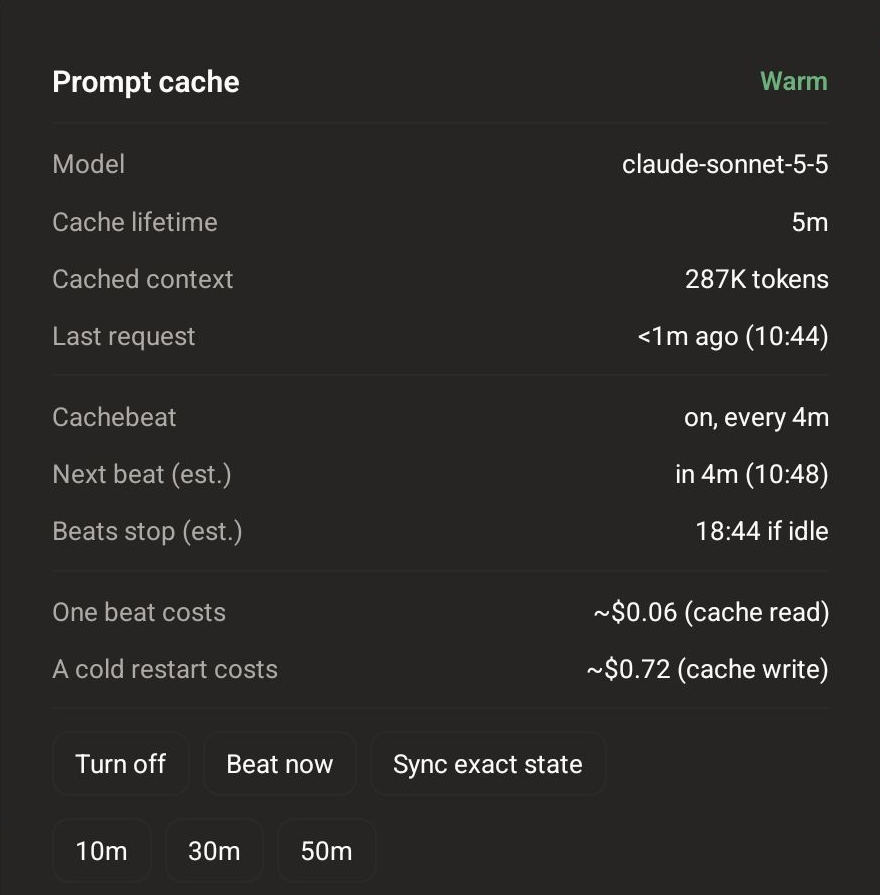

# paseo-cachebeat-pill

A [Paseo](https://paseo.sh) plugin that shows the prompt-cache state of Claude agents as a composer pill, with a card for turning [cachebeat](https://github.com/404Mayank/cachebeat) on or off, beating now and setting its interval.



See [OVERVIEW.md](OVERVIEW.md) for what it shows and its limits.

## Prerequisite

The card controls [cachebeat](https://github.com/404Mayank/cachebeat), a separate Claude Code plugin. Install it in Claude Code first (see its README for the current steps):

```sh
claude plugin marketplace add 404Mayank/cachebeat
claude plugin install cachebeat@cachebeat
```

Cachebeat is off for new sessions. Turn it on per session with `/cachebeat on`, or press **Turn on** in the card. It starts beating after the session's second turn.

## Install

```sh
git clone https://github.com/onggiabayluon/paseo-cachebeat-pill
cd paseo-cachebeat-pill && npm install
paseo plugin install "$PWD"
```

Requires Paseo 0.11.1 or later. After editing the source, run `npm run typecheck` and `paseo plugin reload cachebeat-pill`.
